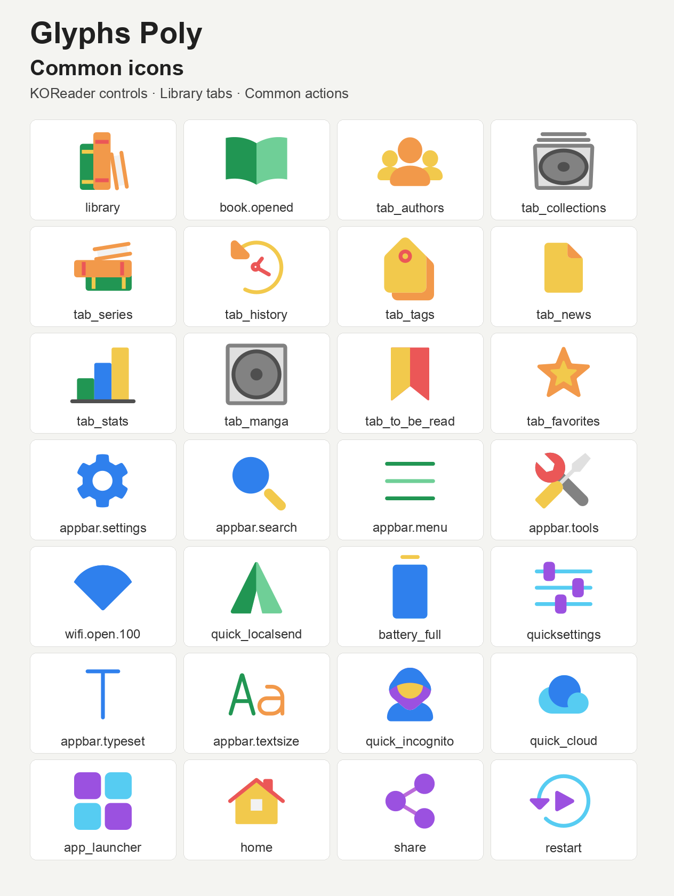

# Glyphs Poly Color Icon Pack for ZenOS

Color replacement icons for [ZenOS](https://github.com/xZenLabs/zen-os),
KOReader, and ZenPM, using [Glyphs Poly](https://icon-sets.iconify.design/glyphs-poly/)
by **Goran Spasojevic**. Created with GitHub's **Use this template** feature from
[Zen icon pack template](https://github.com/xZenLabs/icon-pack-template).

## Icon overviews



## What's included

| Pack | Source SVGs | Built SVG lookups | Release asset |
|---|---|---|---|
| Glyphs Poly | 175 | 252 | `zen-glyphs-poly.zip` |

The pack covers navigation, library tabs, quick actions, reader menus, chevrons,
text alignment, column layouts, stars, open Wi-Fi signal levels, batteries,
ZenPM categories, and package actions. It is a selection mapped to application
lookups, rather than the entire upstream collection.

Native colors and view boxes are retained, including the collection's varied
canvas sizes. Adaptations are limited to recorded rotations, mirroring,
opacity, an outlined empty star, a white star, and a zero-strength Wi-Fi dot.
SVG `use` references are inlined so the full-strength Wi-Fi icon also works
with KOReader's NanoSVG renderer. Related actions may share artwork.

Bluetooth, USB, CPU, database, secured Wi-Fi levels, exact reading-direction and
rotation states, dog-ear status markers, and other unmatched controls keep
their bundled icons. The [source map](icon-sources.json) records every source
icon, checksum, transformation, and omitted source lookup. Font glyphs,
downloaded package logos, and package previews retain their own artwork.
ZenPM replacements require a frontend that supports the selected ZenOS icon pack.

The pack declares `"color": true`. Color e-ink preserves the palette; grayscale
devices display the same artwork in grayscale.

## Install with ZenPM

1. Open [ZenPM](https://github.com/xZenLabs/zen-pm) in KOReader and refresh sources.
2. If Glyphs Poly appears under **Categories → Icon Packs**, select
   `zen-glyphs-poly.zip`, choose **Install**, and confirm queued changes.
3. Choose **Use icon pack** if offered, or select **Glyphs Poly for ZenOS** under
   **Zen Settings → Interface → Custom icons → Custom icon pack**.
4. Enable **Custom icons** and restart KOReader.

If the pack is not in your catalog, use manual installation.

## Manual installation

1. Download `zen-glyphs-poly.zip` from
   [the latest release](https://github.com/xZenLabs/glyphs-poly-icon-pack/releases/latest).
2. Copy the ZIP into `koreader/icons/zen/`, creating the folders if needed.
3. Under **Zen Settings → Interface**, enable **Custom icons** and select
   **Glyphs Poly for ZenOS** under **Custom icons → Custom icon pack**.
4. Restart KOReader. ZenOS validates and extracts the ZIP automatically.

You can also extract the ZIP and copy its `zen-glyphs-poly` folder into that
directory, keeping `pack.json` and the SVGs directly inside the pack folder.
To restore the defaults, disable **Custom icons** and restart KOReader.
See the [ZenOS icon-pack guide](https://github.com/xZenLabs/zen-os/blob/main/docs/icon-packs.md).

## Build and check

```sh
python3 -m venv .venv
source .venv/bin/activate
python3 -m pip install -r scripts/requirements.txt
python3 -m unittest discover -s scripts -p 'test_*.py'
python3 scripts/build-zen-packs.py
```

The output is `dist/zen-glyphs-poly.zip`. To build the style directly or override
the packaged version:

```sh
python3 scripts/build-zen-packs.py "Glyphs Poly" --output dist --version 1.0.0
```

The template builder validates SVG documents, manifests, and archive limits,
preserves the source files, and generates application lookup aliases. Tests
also check source checksums, SVG element compatibility, fallback coverage,
and distinct icon states. SVGs are validated but are not sanitized.

**Actions → Release Zen icon packs** runs on pushes to `main` and manually.
It tests, builds, checks the manifest version, and publishes the installable ZIP.
An increased root manifest version is released exactly; otherwise the workflow
increments the patch above the higher of the manifest version and release tags.
Release runs are serialized.

## Credits and licenses

- **Icons:** [Glyphs](https://github.com/gorango/glyphs) by **Goran Spasojevic**,
  under **MIT**. The full icon license is included in [LICENSE-ICONS.txt](LICENSE-ICONS.txt)
  and in the release ZIP.
- **Pinned source:** [Iconify Glyphs Poly data](https://github.com/iconify/icon-sets/blob/0576187342d061cb9ad9ad6ee922f9ee36974df4/json/glyphs-poly.json)
  at revision `0576187342d061cb9ad9ad6ee922f9ee36974df4`.
- **Packaging:** [xZenLabs](https://github.com/xZenLabs), from the
  [Zen icon pack template](https://github.com/xZenLabs/icon-pack-template).
  Repository code is **AGPL-3.0**; see [LICENSE](LICENSE).

Report problems through [repository issues](https://github.com/xZenLabs/glyphs-poly-icon-pack/issues).
Support ZenLabs projects on [Ko-fi](https://ko-fi.com/xzenlabs).
